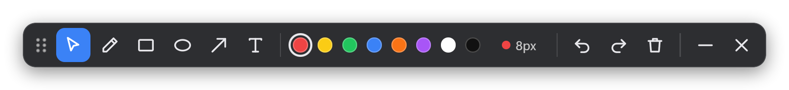

# Overmark



[](https://github.com/robin-vjc/overmark/actions/workflows/ci.yml)
[](https://github.com/robin-vjc/overmark/releases/latest)
[](https://github.com/robin-vjc/overmark/releases)
[](LICENSE)
<br>

**Draw on your screen. Nothing more, nothing less.**

Overmark is a screen annotation tool for presentations, screen sharing, tutorials and recordings. Draw freehand, add rectangles, ellipses, arrows and text on top of any app, then move, resize or delete them like objects in a slide deck.

- ⚡ **Lightweight and fast** (e.g., 1.4 MB Windows installer)
- 🎯 **Simple to use**: a compact toolbar plus single-key shortcuts
- ✨ **Modern looking**
- 🔒 **Private**: no telemetry of any kind ([see how](#privacy))
- 🧩 **Open source**: MIT licensed, contributions welcome
- 🌍 **Cross-platform**: Windows, macOS and Linux

Built with [Tauri](https://tauri.app) and [Konva](https://konvajs.org).

## Install

| Platform                           | Status                                                                                 | Download                                                                                                                                                                                                                                                                                                       |
| ---------------------------------- | -------------------------------------------------------------------------------------- | -------------------------------------------------------------------------------------------------------------------------------------------------------------------------------------------------------------------------------------------------------------------------------------------------------------- |
| Windows 10/11                      |  | [Installer](https://github.com/robin-vjc/overmark/releases/latest/download/Overmark_windows_x64-setup.exe) · [Portable](https://github.com/robin-vjc/overmark/releases/latest/download/Overmark_windows_x64-portable.exe)                                                                                      |
| macOS 11+ (Apple Silicon or Intel) |             | [Disk image (.dmg)](https://github.com/robin-vjc/overmark/releases/latest/download/Overmark_macos_universal.dmg)                                                                                                                                                                                               |
| Linux (x86-64)                     |             | [AppImage](https://github.com/robin-vjc/overmark/releases/latest/download/Overmark_linux_x86_64.AppImage) · [.deb](https://github.com/robin-vjc/overmark/releases/latest/download/Overmark_linux_amd64.deb) · [.rpm](https://github.com/robin-vjc/overmark/releases/latest/download/Overmark_linux_x86_64.rpm) |

These links always download the latest version. Older versions and release notes are on the [Releases](https://github.com/robin-vjc/overmark/releases) page.

On Windows, pick one:

- **Installer**: adds a Start menu entry and an uninstaller, and installs WebView2 if it's missing. An `.msi` is also available on the Releases page for managed deployments.
- **Portable**: nothing to install, just run it. It needs WebView2, which comes with Windows 11 and up-to-date Windows 10. Settings are kept in `%APPDATA%\app.overmark`.

Windows may show a SmartScreen warning because the app isn't code-signed yet. Click **More info**, then **Run anyway**.

On Linux, Wayland support is limited: some compositors restrict always-on-top overlays and global shortcuts.

## Shortcuts

On macOS, use <kbd>Cmd</kbd> instead of <kbd>Ctrl</kbd>.

|     | Action                                      | Shortcut                                                                     |
| :-: | ------------------------------------------- | ---------------------------------------------------------------------------- |
| 👁️  | Show or hide overlay (works from any app)   | <kbd>Ctrl</kbd>+<kbd>Shift</kbd>+<kbd>D</kbd>                                |
| 🖱️  | Select, move, resize, rotate; click-through | <kbd>V</kbd>                                                                 |
| ✏️  | Pen                                         | <kbd>P</kbd>                                                                 |
| ⬜  | Rectangle                                   | <kbd>R</kbd>                                                                 |
| ⭕  | Ellipse                                     | <kbd>E</kbd>                                                                 |
| ↗️  | Arrow                                       | <kbd>A</kbd>                                                                 |
| 🔤  | Text                                        | <kbd>T</kbd>                                                                 |
| 🎨  | Red / yellow / green / blue                 | <kbd>1</kbd> <kbd>2</kbd> <kbd>3</kbd> <kbd>4</kbd>                          |
| 📏  | Pen width or text size                      | <kbd>Ctrl</kbd>+<kbd>Scroll</kbd>                                            |
| 🗑️  | Delete selected                             | <kbd>Del</kbd>                                                               |
| ↩️  | Undo                                        | <kbd>Ctrl</kbd>+<kbd>Z</kbd>                                                 |
| ↪️  | Redo                                        | <kbd>Ctrl</kbd>+<kbd>Y</kbd> / <kbd>Ctrl</kbd>+<kbd>Shift</kbd>+<kbd>Z</kbd> |
| 🧹  | Clear all                                   | <kbd>Ctrl</kbd>+<kbd>Shift</kbd>+<kbd>X</kbd>                                |
| ⏹️  | Deselect, then back to Select               | <kbd>Esc</kbd>                                                               |

- Hold <kbd>Shift</kbd> while drawing for squares, circles and 45° arrows.
- With shapes selected, <kbd>Ctrl</kbd>+<kbd>Scroll</kbd> and the color keys change those shapes.
- In Select mode, double-click text to edit it. <kbd>Esc</kbd> or <kbd>Ctrl</kbd>+<kbd>Enter</kbd> finishes editing.
- Keyboard shortcuts other than the global one only work while Overmark has focus. After you click through to another app, click an annotation or the toolbar first.

## Build from source

Prerequisites: [Rust](https://rustup.rs), [Node.js](https://nodejs.org) 20.19+, [pnpm](https://pnpm.io), and the [Tauri prerequisites](https://v2.tauri.app/start/prerequisites/) for your OS.

```sh
git clone https://github.com/robin-vjc/overmark.git
cd overmark
pnpm install
pnpm tauri dev      # run in development
pnpm tauri build    # produce an installer
```

## Privacy

Privacy is enforced by the app's configuration:

- The webview has a strict Content Security Policy that blocks outside connections.
- The app is granted no network, filesystem or shell permissions ([`capabilities/default.json`](src-tauri/capabilities/default.json)).
- There is no telemetry and no auto-updater.
- The only file it writes is its own `settings.json`.

## Alternatives

These are other tools similar to Overmark. None quite fit what I was looking for:

- [Epic Pen](https://epicpen.com/)
- [ZoomIt](https://learn.microsoft.com/en-us/sysinternals/downloads/zoomit), part of Microsoft's [PowerToys](https://github.com/microsoft/PowerToys)
- [gInk](https://github.com/geovens/gInk)
- [Pointofix](https://www.pointofix.de/hilfe_en.php)

## Contributing

Contributions are welcome! See [CONTRIBUTING.md](CONTRIBUTING.md) for the project structure, coding style and how to submit a pull request.

## License

[MIT](LICENSE)
